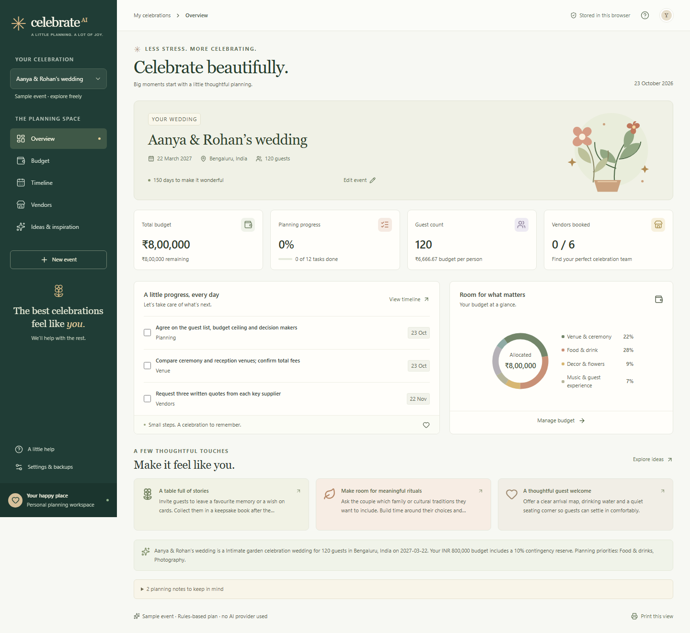
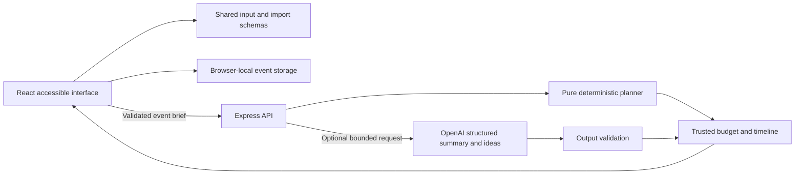

# Celebrate AI · Celebration & Event Planner

[](https://github.com/Pradhyut21/celebrate-ai-event-planner/actions/workflows/ci.yml)
[](https://github.com/Pradhyut21/celebrate-ai-event-planner/actions/workflows/codeql.yml)
[](LICENSE)

**Challenge 5 vertical: Celebration & Event Planner.** A working GenAI assistant for a person organizing a wedding, birthday, or community gathering. Turn an event brief into an exact budget, a practical timeline, supplier checklists, and ideas shaped by guest needs and personal preferences.

No account or API key is needed to try the complete rules-based planner. With a server-side OpenAI key, the assistant personalizes the summary and ideas. The interface identifies which mode produced the plan and explains provider failures.



## Run locally

Requires **Node.js 22.18+**, npm, and Git.

```bash
git clone https://github.com/Pradhyut21/celebrate-ai-event-planner.git
cd celebrate-ai-event-planner
npm ci
npm run dev
```

Open **http://127.0.0.1:5173**. The API runs on port 3001. Start with the clearly labeled sample event, or choose **New event**. Browser data stays in that browser; the app does not create a server-side event database.

For a production build:

```bash
npm run build
npm start
```

Open **http://127.0.0.1:3001**. The same server serves the compiled interface and API. To run on another port, set both `PORT` and the matching `APP_ORIGIN` (for example, `http://127.0.0.1:4000`) in `.env`. Set `HOST=0.0.0.0` only when intentional network access is needed. Use HTTPS and an exact `APP_ORIGIN` for hosting.

## What works

| Organizer task                | Implemented behavior                                                                                                                                    |
| ----------------------------- | ------------------------------------------------------------------------------------------------------------------------------------------------------- |
| Plan different celebrations   | Separate wedding, birthday and community templates with relevant milestones, cost categories and supplier checks.                                       |
| Work within a budget          | Priority-weighted allocations, a 10% contingency, exact cent rounding, editable actual spending, remaining funds and overspend indicators.              |
| Meet deadlines                | Event-relative milestones, compressed schedules clamped to today, completion tracking and overdue visibility.                                           |
| Compare suppliers responsibly | Editable vendor names, quotes and booking stages plus practical due-diligence checklists. No invented supplier listings or claims of live availability. |
| Make the plan personal        | Style, location, guest count, priorities, dietary needs, access requirements and free-text notes influence rules and optional AI suggestions.           |
| Keep progress                 | Multiple events, browser persistence, validated JSON backup/restore, budget CSV and printable plans.                                                    |
| Use inclusive controls        | Semantic landmarks, labeled inputs, keyboard navigation, native dialogs, visible focus, reduced motion and responsive layouts.                          |

## Approach and decision logic

1. **Validate the brief.** Shared Zod schemas reject invalid calendar dates, nonfinite or overprecise amounts, out-of-range guest counts, unknown fields and oversized text. Past event dates are rejected when generating a new plan.
2. **Choose a relevant template.** Wedding plans include ceremony and RSVP milestones; birthdays include cake and inclusive activities; community events include volunteers, permits, capacity and operations.
3. **Allocate money deterministically.** Reserve 10% of the total in integer cents, increase weights for selected priorities, add an accessibility category when requested, and distribute the balance using largest remainders. Category totals always equal the input budget, including a one-cent budget.
4. **Build a feasible schedule.** Subtract milestone offsets from the event date, clamp elapsed deadlines to today, add dietary/access/weather tasks when relevant, and sort by date. Compressed lead times produce an explicit warning.
5. **Generate contextual ideas.** Built-in rules cover event type and stated preferences. Optional AI enrichment receives only the event brief and can change the summary and ideas; it cannot change trusted amounts or task dates.
6. **Track changes locally.** Record actual costs, task completion and supplier progress. Validate imported data against both field schemas and cross-field budget/date invariants before replacing browser state.

**Example:** A garden birthday for 24 people with a ₹12,000 budget, vegetarian food and step-free access gets a ₹1,200 contingency, an access/comfort category, dietary and access confirmation tasks, a weather-backup task and inclusive activity ideas. Spending ₹15,000 triggers an over-budget indicator. The application does not treat allocations as market quotes.

## Enable real generative AI

Copy `.env.example` to `.env` and fill in the server-side values:

```dotenv
OPENAI_API_KEY=your-provider-key
OPENAI_MODEL=gpt-4o-mini
PLANNER_ACCESS_TOKEN=replace-with-a-random-value-at-least-16-characters
```

Restart the server. Enter the access token in the app's AI settings when requested. Keep it out of shared screenshots and exports. The provider key never belongs in browser code, a `VITE_` variable, source control or an import file. The access token protects the cost-bearing proxy; it is not a multi-user account system.

The provider uses the [OpenAI Responses API with Structured Outputs](https://developers.openai.com/api/docs/guides/structured-outputs), `store: false`, a fixed provider endpoint, bounded output and a request timeout. Model availability depends on the supplied account; `OPENAI_MODEL` is configurable. Output is validated again before use. Network errors, refusals, malformed responses and incomplete responses return a clearly marked rules-based plan. There is no silent claim of AI success, no tool execution and no automatic booking.

The provider receives the brief only when generation is requested with AI configured. Event names, notes and stated preferences may contain personal information: avoid sensitive details. `store: false` is not a promise of zero provider retention; consult the provider's data policy for your account. Local rules need no outbound provider request.

## Architecture



```text
src/shared/       Validated contracts, immutable templates and pure planning rules
src/server/       HTTP composition, security middleware, configuration, resource limits and AI adapter
src/client/       Views and components, focused hooks, validated HTTP service and pure workspace reducer
tests/           Domain, API, provider and client regression tests
tests/e2e/       Real browser workflows and automated accessibility checks
docs/            Threat model, evaluation evidence and verification record
scripts/         Submission size, branch and accidental-secret checks
.github/         Pinned CI/security workflows and dependency monitoring config
```

The server stores no event records. Request and provider output sizes, network time and concurrent generations are bounded. AI rate-limit state has an explicit capacity and expiry; page requests use a separate expiring limiter. Planning costs are linear in the small fixed template size; the browser reuses an event's saved plan without making AI requests for edits to spend or checklists. Production code splits the UI bundle from the server; no browser SDK or heavyweight media is required.

Workspace changes are applied by a pure reducer against the latest state, so queued edits and asynchronous imports preserve other changes. Typed plan editors keep allocation, actual spending, supplier details and checklist progress separate. Backup parsing, budget arithmetic and formula-safe CSV generation have focused modules. The entry point only mounts the application; an editor hook owns create/edit state and keeps request failures inside the active dialog. The planner composes private budget, timeline, idea and warning functions around shared validated contracts. Server configuration, security middleware and bounded resource policies are separate from route composition. See [maintenance guidance](docs/MAINTENANCE.md) for extension points and invariants.

## Verify the submission

```bash
npm ci
npm run check
npx playwright install chromium
npm run test:e2e
npm audit --audit-level=high
```

`npm run check` runs strict TypeScript with checked indexed access, type-aware lint (including async safety and accessibility), formatting, coverage-gated tests, production build, compressed-asset budgets and tracked-repository checks. On a fresh checkout, files are already tracked. If adding files, stage them before the size check. Coverage includes shared rules, all server policy/HTTP/provider modules and browser data/service modules; browser workflows exercise the rendered interface and hooks. The verified suite contains **157 unit/integration tests and 14 browser tests**. Exact coverage and browser results are recorded in [verification results](docs/VERIFICATION.md). Automated accessibility scans supplement keyboard checks and do not establish complete WCAG conformance.

GitHub Actions repeats these checks on `main`, saves reports as workflow artifacts and runs CodeQL security analysis. The security workflow also fails when high or critical CodeQL findings remain open after analysis. Actions use pinned commits and limited permissions. No test requires a provider key or paid request. Live paid-provider calls are not part of automated verification.

See [evaluation evidence](docs/EVALUATION.md), [verification results](docs/VERIFICATION.md), [threat model](docs/THREAT_MODEL.md), [security policy](SECURITY.md) and [contribution guide](CONTRIBUTING.md).

## Assumptions and limits

- This is a personal organizer with local browser persistence, not a multi-user booking platform. Clearing site data removes local records; export backups for portability. Browser storage and exported files are not encrypted.
- Prices are planning targets. Real quotes, taxes, deposits, availability, insurance and local requirements must be confirmed with responsible vendors or organizers.
- Money supports INR, USD, EUR and GBP to two decimal places. No exchange-rate conversion is performed. Event dates are calendar dates; the server uses UTC for its definition of today. Individual guests and their contact information are not collected.
- A 10% contingency and per-person feasibility warnings are explicit heuristics. Priorities influence estimates; they do not establish local purchasing power.
- The shared access token, in-memory limiter and concurrency cap suit one server instance. Internet-facing or multi-instance service requires identity, per-user quotas, durable/shared rate limits and deployment-specific proxy configuration.
- Generated ideas can be mistaken. Dietary and accessibility requirements require direct confirmation; cultural traditions are based on stated preferences rather than inferred identity.

## Submission

Public source: **https://github.com/Pradhyut21/celebrate-ai-event-planner**. Keep **one branch (`main`)** and a repository smaller than **10 MB**. Dependencies, build output, test artifacts and recordings are excluded. A demo/video is not required to inspect or run the source; upload any separately requested video outside the repository. This project implements one challenge vertical only.

MIT licensed. Built for the Challenge 5 celebration organizer persona.
